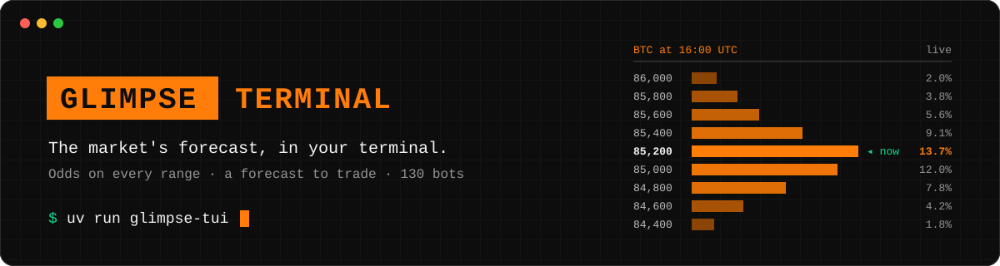
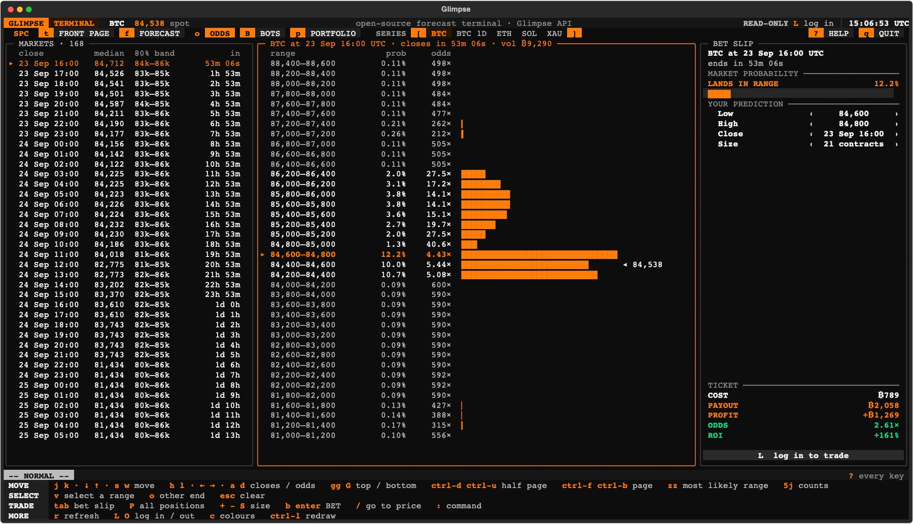
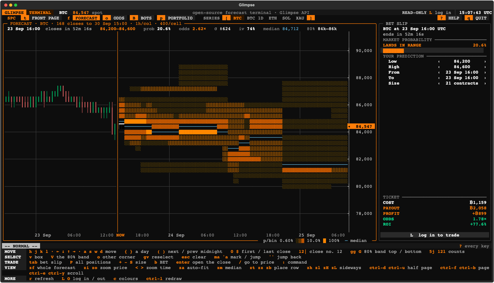
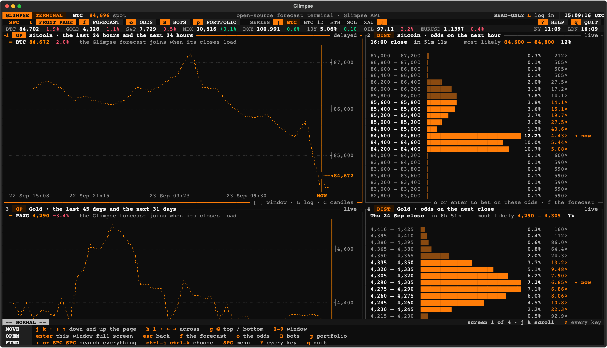
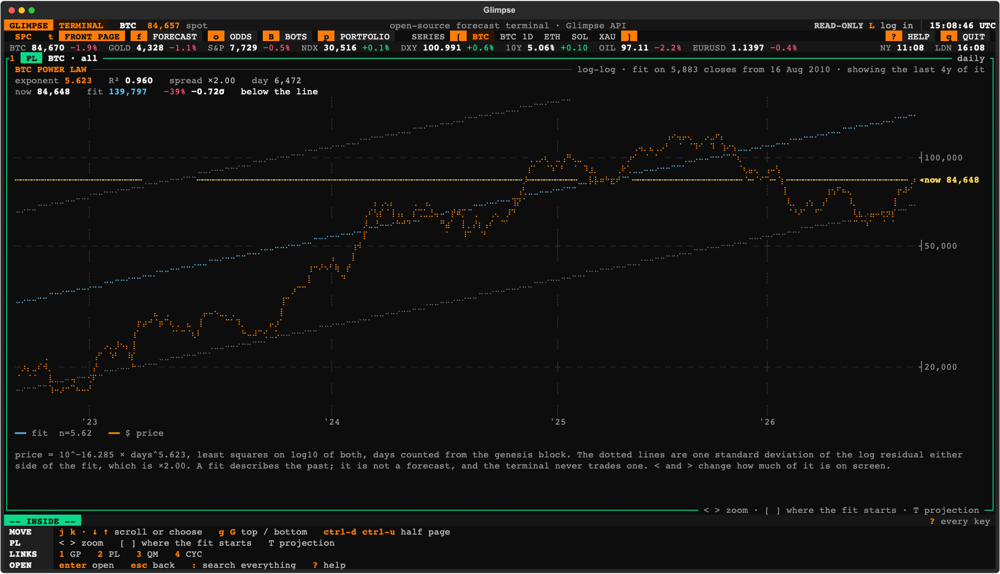
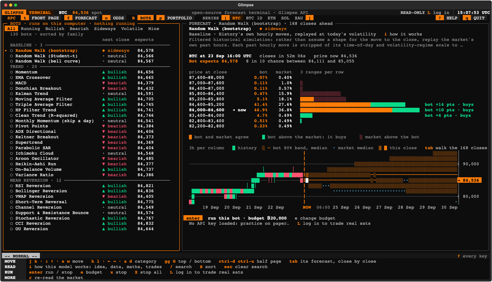
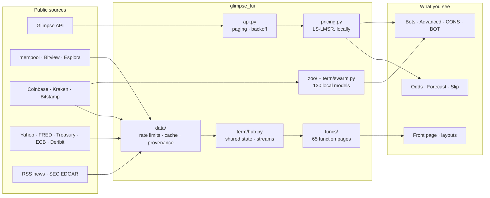

<div align="center">



<br>

**A keyboard-driven terminal for [Glimpse](https://www.glimpse.markets/forecast) prediction markets, the price forecast they add up to, and the world around them.**

[](LICENSE)
[](https://www.python.org/)
[](https://textual.textualize.io/)
[](https://docs.astral.sh/uv/)
[](https://docs.astral.sh/ruff/)
[](#development)
[](#where-the-numbers-come-from)

[What is Glimpse?](#what-is-glimpse) ·
[The forecast](#the-price-forecast) ·
[Quick start](#quick-start) ·
[Tour](#a-tour-of-the-terminal) ·
[Bots](#the-bot-zoo) ·
[Keys](#moving-around) ·
[Data](#where-the-numbers-come-from) ·
[Hacking](#development)

</div>

<br>

<p align="center">
  
  <br>
  <sub><b>The first screen.</b> Every price range for Bitcoin's next hourly close, the market's probability of each, what it pays, and the bet slip a <code>tab</code> away.</sub>
</p>

---

## ✨ Highlights

|  |  |
|---|---|
| 🎯 **Opens on the odds** | One screen covers placing a bet: every outcome of Bitcoin's next close, priced, with the cursor on the most likely range. |
| 🔥 **The forecast, as a heatmap** | A week of closes laid side by side becomes one orange cloud of probability. Box a region with `v` and trade it. |
| 🌍 **A front page for the world** | Bitcoin, gold, hashrate, the news, rates, dollar liquidity, FX and commodities on one long scrolling page. |
| 🤖 **150 bots run on your laptop** | The Glimpse Forecast Lab's model zoo computes from public candles on your own machine. Watch every bot, run one on paper, or write your own in one function. |
| 🔺 **Bots across markets** | The Triangulator makes one forecast of Bitcoin and gold and bets its likely band across three books at once, every leg in one request. Watch it work on three ladders on `A`. |
| 🖥️ **A desk for the bots** | `M` is the monitor: every bot running, what each holds across every market drawn over the market's forecast, what it is worth, and every order as it fills. |
| 📈 **The power law** | Bitcoin's log-log regression from the genesis block, with how far today's price sits from the line. |
| ₿ **Priced in Bitcoin** | Any ticker has a satoshi form: `XAUBTC`, `SPXBTC`, `NVDABTC`. Press `$` to reprice a whole table. |
| ⌨️ **Moves like spacemacs** | Vim keys, windows and buffers, `SPC` as the leader, and `:` to search everything. |
| 🔓 **Free data, no account** | Every default source is public and keyless. Point it at your own node, or run every request through Tor. |
| 🧪 **Tested offline** | 876 tests replay recorded responses, so no test touches the network. |

---

<a id="what-is-glimpse"></a>

## 🔮 What is Glimpse?

[Glimpse](https://www.glimpse.trading) is a Bitcoin-denominated prediction market on **where a price will close.** Deposits and withdrawals go over the Lightning Network.

Most prediction markets ask a yes-or-no question. Glimpse asks for the whole shape of the future:

> **"Where will Bitcoin be at 16:00 UTC on 23 September?"**

Each close, which Glimpse calls a *market*, is cut into **500 adjacent price ranges**. Every range is a contract that pays **100 sats if the price closes inside it**, and nothing if it doesn't. So you can bet on the exact range you think the price will land in, and not only on up or down.

```
   BTC at 23 Sep 16:00 UTC                       closes in 53m
   range                 prob     odds
   85,000 – 85,200       2.0%    27.5×   ▇▇
   84,800 – 85,000       1.3%    40.6×   ▇
 ▸ 84,600 – 84,800      12.2%    4.43×   ▇▇▇▇▇▇▇▇▇▇▇▇▇▇▇▇▇▇▇▇▇▇▇▇▇▇▇▇
   84,400 – 84,600      10.0%    5.44×   ▇▇▇▇▇▇▇▇▇▇▇▇▇▇▇▇▇▇▇▇▇▇▇     ◂ now
   84,200 – 84,400      10.7%    5.08×   ▇▇▇▇▇▇▇▇▇▇▇▇▇▇▇▇▇▇▇▇▇▇▇▇▇
```

Series run back to back. `BTC` and `XAU` (gold, settled on PAXG) have a close every hour for the week ahead, and there are also `BTC 1D` and `XAU 1D` (daily closes), `ETH` and `SOL`. `WTIBTC` is a barrel of WTI crude priced in satoshis (WTI in dollars over Bitcoin in dollars) and `XAUTBTC` an ounce of Tether Gold priced in satoshis, each with a close every hour for the week ahead. No exchange quotes them, so their price history and spot come from Glimpse's own oracle, the price the market settles on. `HASHPRICE` is what a PH/s of hash rate earns in a day, in dollars, with a close every UTC midnight for weeks ahead; it settles on Bitview's `hash_price`, which is also its price feed. `DIFFICULTY` and `ADJUSTMENT` are the difficulty each of the next twelve retargets sets, in terahash, and the percent change it makes; they settle on the chain at a block height, not at a time, and trading stops three blocks before it.

### How prices are set

Nobody has to be on the other side of your trade. An automated market maker quotes every range at every moment using the **liquidity-sensitive logarithmic market scoring rule (LS-LMSR)**. With $q_i$ contracts outstanding on range $i$ of $n$:

$$
C(\mathbf{q}) \;=\; b(\mathbf{q})\,\ln \sum_{i=1}^{n} e^{\,q_i / b(\mathbf{q})},
\qquad
b(\mathbf{q}) = \alpha \sum_i q_i,
\qquad
\alpha = \frac{V}{m \ln m},
\qquad
m = \min(n, 500)
$$

A trade costs the change in $C$, scaled to 100 sats a contract. The main service sizes $\alpha$ on the ladder's own length up to 500 ranges, so WTI/BTC's 250 ranges are priced on 250 and SOL's 650 on 500. Hashprice runs on a second service with no cap, so its 1,000 ranges are priced on 1,000. The price of a range is the marginal cost of one more contract. Buying a range makes it dearer and the others cheaper. On LS-LMSR the prices sum to slightly more than 100, so the terminal normalises them into the probability it shows. A 2% commission applies on buying, selling and redemption.

The public quotes endpoint rounds each price to a whole sat, which reads as zero for most of a 500-range market. The terminal therefore **recomputes every price locally from the outstanding shares.** [`pricing.py`](src/glimpse_tui/pricing.py) holds those pure functions and is short enough to read in one sitting. The [Glimpse whitepaper](https://www.glimpse.trading/whitepaper/) has the full derivation.

---

<a id="the-price-forecast"></a>

## 📊 The price forecast

Put one market's probabilities in a column. Put the next close's column beside it, then the next, for all 168 hourly closes of the coming week. **The result is a forecast:** the crowd's probability distribution for the price at every hour ahead, set by people with money on it.

<p align="center">
  
  <br>
  <sub><b>The forecast (<code>f</code>).</b> Time runs across and price runs up. The more solid the orange, the more probability the market puts on that range. Candles sit left of <code>NOW</code> and the median is in cyan.</sub>
</p>

Each character cell is one price range at one close, shaded `░ ▒ ▓ █` on a single log scale of probability. The picture reads as a shape to look at, not a colour key to decode. From here you can:

- **Read it.** The median, the 80% band, the market's implied volatility, and the odds under the cursor.
- **Select it.** `v` starts a box and `V` selects the 80% band. A box over several closes places *one order per close*, each priced at that close's own book.
- **Price it.** `tab` opens the bet slip and `P` lists every position before anything is sent: chance, contracts, cost, payout, profit, odds and ROI, with a total.
- **Trade it.** `b` bets. The confirmation *is* that table, so no order goes out that you haven't seen priced line by line.

`OMON` reads the same distributions as an options chain: digital calls, puts and ranges on each close, an implied volatility from a lognormal fit, and the Greeks. `GIV` compares Glimpse's implied volatility with Deribit's.

---

<a id="quick-start"></a>

## 🚀 Quick start

You need Python 3.12+ and [uv](https://docs.astral.sh/uv/). No account, API key or config file is needed to look around.

```sh
# run it straight from GitHub
uv tool install git+https://github.com/BIRKELAND-GLIMPSE/glimpse-tui
glimpse-tui

# or clone and hack on it
git clone https://github.com/BIRKELAND-GLIMPSE/glimpse-tui
cd glimpse-tui
uv run glimpse-tui
```

```sh
glimpse-tui                # the odds on Bitcoin's next hour
glimpse-tui --terminal     # open on the front page: charts, the chain, the news, the world
glimpse-tui "PL BTC"       # open on any command: "PL XAUBTC", "DIST BTC", "FCST XAU", NEWS, "LP MACRO"
glimpse-tui DEMO           # a ninety-second guided tour
```

It runs anywhere Python does, including over SSH. If the colours look wrong, press `c` to switch between 24-bit colour and a palette built only from colours a 256-colour terminal draws exactly.

---

<a id="a-tour-of-the-terminal"></a>

## 🧭 A tour of the terminal

### The front page

The odds are the front door. **Behind them, on `t`, is the terminal:** one long page, most important first. `j` and `k` walk down it window by window, `enter` opens a window full screen, and `esc` comes back.

<p align="center">
  
</p>

In order down the page:

1. **Bitcoin.** The last 24 hours and the next 24, beside the odds on the next hour.
2. **Gold.** Its last 24 hours and the odds on its next hour.
3. **The chain.** Hashrate and the difficulty adjustment.
4. **The world.** The news, beside a world quote monitor.
5. **The power law.** For Bitcoin, and for gold priced in Bitcoin.
6. **Macro.** Dollar liquidity, the Treasury curve and economic prints.
7. **FX and commodities.** Commodities are priced in satoshis.
8. **Fees.** What the next block costs.

`opens_on = "terminal"` in `~/.config/glimpse/terminal.toml` makes the front page the default. Other layouts ship too: `LP BOTS`, `LP MACRO`, `LP TRADER`, `LP TREASURY`, `LP CHAIN`, `LP MINER`. `LP SAVE desk` saves your own.

### The power law

<p align="center">
  
</p>

Bitcoin's price has tracked a straight line on log-log axes for its whole life. `PL BTC` fits `price = 10^a × days^n` by least squares, counting days from the genesis block. It shows the exponent, R², the residual spread, and how far today's price sits from the line, in percent and in standard deviations.

- `[` `]` move where the fit starts, and the exponent moves with it. That is the point of showing it.
- `<` `>` change how much history is on screen. The fit always uses every close.
- `T` shows what the line reads one, two, four and ten years out.

`PL XAUBTC` is the same picture for gold priced in Bitcoin. Its exponent is negative: an ounce costs fewer satoshis every year.

> [!NOTE]
> A fit is a description of the past with an error bar. The terminal never trades one.

### Priced in Bitcoin

Put `BTC` on the end of any ticker and it is priced in satoshis. Gold becomes `XAUBTC` at about ₿5,400,000 an ounce, the S&P 500 becomes `SPXBTC`, and a share of NVIDIA becomes `NVDABTC`. Those tickers work everywhere a ticker does: `GP XAUBTC` charts gold in sats, `PL SPXBTC` fits its power law, and `QM COMMODITIES SATS` opens a watchlist already in that unit.

Nothing extra is fetched for them. The quote board divides the two prices it already has, and a ratio history uses only the days both markets closed. On `QM`, `WEI` or `GLCO`, `$` flips the whole table between dollars and satoshis.

### 65 functions

Type `:` (or `SPC SPC`) and start typing to search everything. Every function has a `HELP` page that says what it shows, where each number comes from, how often it refreshes, and what it does when a source is down.

<details>
<summary><b>Every function, by family</b></summary>

<br>

| Family | Functions |
|---|---|
| **Glimpse** | `ODDS` the odds, close by close · `HM` the forecast heatmap · `FCST` a forecast as a pane · `DIST` the odds on the next close · `SLIP` the bet slip · `PORT` your portfolio · `OMON` every close as an options chain · `GIV` Glimpse's implied vol against Deribit · `CONS` what the whole zoo expects · `BOT` one model against the market · `BOTS` the model zoo · `ADV` bots across several markets · `NOC` the monitor: every bot running, what it holds, every fill |
| **Bitcoin** | `BTC` the Bitcoin page · `MEMP` mempool and the next block · `FEES` fees and a calculator · `BLK` blocks · `TX` a transaction · `ADDR` an address · `RBF` live replacements · `MINE` pools · `HASH` hashrate and difficulty · `DIFF` the retarget · `HASHP` hashprice · `DFF` the coming retargets against their markets · `HALV` the halving · `SUPL` supply · `LN` Lightning · `ORCL` the price read from the chain alone |
| **On-chain** | `FLDS` search 60,000 Bitview series · `GP` chart anything · `ONCH` the cycle dashboard · `URPD` realized price distribution · `WAVE` HODL waves · `CYC` valuation bands · `CORR` rolling correlations |
| **Markets** | `NEWS` world, economy, markets, Fed, ECB and crypto headlines · `READ` a story, as text · `QM` quote monitor · `WEI` world indices · `FX` currencies and the dollar index · `GLCO` commodities · `RATES` the Treasury curve · `MACRO` dollar liquidity · `ECO` economic prints · `HMAP` performance heatmap · `RV` BTC against gold · `DVOL` implied volatility · `PL` the power law |
| **Companies** | `DES` description · `FA` financials · `CF` filings, read in the pane · `CFS` full-text search · `TRSY` Bitcoin treasuries · `MINR` public miners · `ETF` spot ETFs · `N` news and filings · `TOP` the feed |
| **Tools** | `AL` alerts · `NOTE` notes · `CALC` sats, fees, Kelly · `EXP` export · `SRC` every source's health · `SET` settings · `ASK` plain English into a command · `HELP` · `FIND` · `DEMO` |

Some commands to try:

```
CONS BTC        what every bot expects            GP BTC 24H     Bitcoin's next 24 hours
FCST XAU        gold's next 48 hours as a heatmap NEWS FED       the Fed's headlines, read in place
DIST BTC        the odds on the next close        QM STOCKS SATS a stock watchlist in satoshis
RATES           the Treasury curve                HELP DIST      one function's help page
```

</details>

---

<a id="the-bot-zoo"></a>

## 🤖 The bot zoo

Glimpse is a market you can bring a model to. The terminal ships with **150 bots**: 131 forecasting models from the Glimpse Forecast Lab, 8 opportunistic bargain hunters built on them, the Bill Benter bot, 5 smoothing bots that trade the whole series as one surface, two Triangulators, which make one forecast of Bitcoin and gold (or Bitcoin and oil) and bet its likely band across every book that prices it, two Arbitrageurs, which cover one close across two series (Bitcoin's, and gold's), and the Profit Taker, which only sells. They run **on your own computer**, from public hourly candles, and nothing about them leaves your machine.

**Every picture knows the weekend.** All the models size from one shared volatility clock, and since 31 October 2026 that clock keeps the calendar: the quiet hours (CME's closed hours for gold and oil, Friday 22:00 to Sunday 23:00 UTC and the 22:00 hour each day; Saturday and Sunday for Bitcoin and the other markets that never close) get their own σ, measured as a fraction of a busy hour's. Measured that day, Bitcoin's weekend hours move at half its weekday σ, gold's at a quarter, WTI/BTC's at 0.4, while the ladders are priced as if every hour traded. So a picture drawn on Friday evening for Monday morning is as narrow as the weekend between really is, and on weekdays the models forecast at full volatility as before. The Session Walk in the Baseline family is that clock as a model of its own.

<p align="center">
  
  <br>
  <sub><b>Bots (<code>B</code>).</b> Each row says what that bot believes about the next close right now. On the right, the bot's picture is laid over the market's. Green is where the bot thinks a range is underpriced, which is what it would buy.</sub>
</p>

| Family | Bots | For example |
|---|---:|---|
| Distributions | 26 | Student-t, Skew-Normal, Merton Jumps, Calm or Storm, Empirical History |
| Options views | 25 | Covered Call, Protective Put, Bull Call Spread |
| Trend | 20 | Momentum, EMA Crossover, MACD, Donchian Breakout, Kalman Trend, Ichimoku Cloud |
| Scenario | 15 | Bull Case, Slow Grind Up, Neutral Range, Slow Bleed |
| Mean reversion | 12 | RSI Reversion, Bollinger Reversion, VWAP Reversion, OU Reversion |
| Volatility · HAR · GARCH | 9 | Bollinger Squeeze, Leverage Effect, HAR-RV, GARCH-skew |
| Regime & jumps | 7 | Markov Regime, Change-point Drift, Kou Gap Risk, Hawkes Cascade |
| Calendar & cycles | 6 | Hour of Day, Day of Week, Turn of the Month, Pre-FOMC Drift |
| Pattern & ML | 5 | Analogs, Candlestick Patterns, Neural Net Direction, Naive Bayes State |
| Baseline | 4 | Random Walk (bootstrap, Student-t, bell curve), Session Walk |
| Factor & carry | 2 | Low-Volatility Anomaly, Skewness Premium |
| Opportunistic | 8 | Bargain Hunter (near spot, upside, downside), Discount Sweep, Signal Bargains, Longshot Collector, Crash Insurance, Moon Tickets |
| Smoothing | 5 | Surface Pool, Dirichlet Blend, Kalman Surface, Particle Bridge, Band Match |
| Arbitrage | 4 | Triangulator, Oil Triangulator, Arbitrageur, Gold Arbitrageur |

**Opportunistic bots** hunt for bargains instead of backing a view. Each one pools the zoo's volatility and jump models into one carefully calibrated picture. It then buys only ranges the market sells cheap (a few sats or less), only where that picture says they are worth 1.25 to 2 times their price after both fees, and only in its own part of the ladder: near spot for sideways, above for bullish, below for bearish, far out in the tails for longshots. Every stake is a small fixed share of the budget spread over many ranges. That way a positive expected value, repeated over many closes, becomes a return. Like every bot, they take profit: a ticket the market bids up past its worth and its cost is sold back, partly or wholly. The rest are held to the close, the longshot and insurance tickets included. Your own bot can trade the same way by setting `POLICY = {"max_price": 3, "region": "above"}` in its file.

- **`CONS`** runs the whole zoo against the live market at three horizons (next hour, 24 hours, 72 hours). It counts bulls against bears and draws the one picture they make together beside the market's.
- **`BOT`** takes the zoo one model at a time. `[` and `]` walk through it.
- **`BOTS` (`B`)** is the full screen. `i` opens a model's account of itself: the idea, the data, the maths and how it trades.
- **`enter` runs a bot.** It runs on paper by default. With an API key and the word `LIVE` it trades real sats, never above its budget, and checks the server's estimate before every order. It works through the series one close at a time, every 5 seconds, nearest to farthest and then round again. On each visit it reads that close's odds fresh and draws its forecast of that close. Then it trades both ways. It takes profit: while the market pays more for a range it holds than the forecast says it is worth and more than it cost, it sells, often only part of the position, and keeps the rest. Then it buys where the market's odds fall short of its forecast, never paying more for a contract than its forecast says it is worth, so every buy has positive expected value. What a sale frees of the budget it can spend again. Set `profit_only = false` in `bots.toml` to let it also trim overpriced positions held at a loss. Each close gets an even share of the budget (a 100,000 sat budget over 168 hourly closes is 595 sats a close), so one round reaches every close. The budget is per series: what the same bot holds in another series doesn't use it up. Every visit writes one line to the log under the bot: what it bought or sold, or why it did nothing. `objective = "edge"` in `~/.config/glimpse/bots.toml` switches to fractional Kelly on ranges at least 4% under value. `P` shows the bot's whole portfolio.
- **`R` lets a bot manage your portfolio.** Pick any model, press `R`, and it rebalances every position your account holds in the series toward that model's forecast, including ones you opened yourself. It visits one close at a time like any running bot, and on each visit it sells what the market pays more for than the forecast says a position is worth, and buys what the market sells below its value. By default it sells only at a profit over what you paid, so it never locks in a loss because one model disagrees with you. Set `profit_only = false` in `bots.toml` to let it trim overpriced losers too. Its budget is the fresh sats it may add, and whatever it sells it can spend again. It needs your API key, even on paper: on paper it trades a copy of your portfolio and sends no orders. Only one bot at a time can manage a series.
- **The Triangulator makes one forecast and bets it across three markets.** Bitcoin, gold and Tether Gold in satoshis close at the same second, and an ounce in sats is an ounce in dollars × 10⁸ over Bitcoin in dollars, so each pair of books implies the third. The bot draws its lens's picture of each of the three closes (the Session Walk by default, a Student-t walk over the hours the market actually trades), pools each with the picture the other two imply, and bets on the likely outcomes: the band holding 80% of that picture, bought as a set of equal contracts in every book that sells it under what it pays, every leg in one request. The Oil Triangulator does the same for Bitcoin and WTI/BTC, with oil's dollar price as a model in place of the missing third market. Both live on the advanced screen (`A`), where you watch them on three ladders at once. See [The Triangulator](#the-triangulator).
- **The Arbitrageurs buy both sides of one close in two series.** Every hourly WTI/BTC close settles at the same second as an hourly Bitcoin close, and at 00:00 UTC the daily Bitcoin close joins them; gold closes the same way in dollars (`XAU`, `XAU 1D`) and in satoshis an ounce (`XAUTBTC`, Tether Gold). When two books on one event disagree, the bot buys across them the cheapest set of ranges that holds the settlement price wherever it lands, so at least one contract pays whichever way the price moves, and only when that costs less than it pays. It takes no view on direction. See [The Arbitrageurs](#the-arbitrageurs).
- **Profit Taker sells what the crowd overpays you for.** It sits at the end of the list, under Portfolio. Press `enter` on it. It reads every position your account holds, in every series, whoever opened it, and visits only the closes you hold, one a second. When other traders bid a range you own up past what the zoo's consensus says it is worth, it sells as many of your contracts as the market overpays for. It only sells at a profit over what you paid, after both 2% fees, and it keeps the rest. It never buys, so it has no budget. It needs your API key, even on paper; type `LIVE` to sell for real. A portfolio manager (`R`) would sell the same positions, so the terminal won't run both at once.

A full pass over the zoo takes about a second per asset and reruns each time a new hourly bar closes. The whole engine stays under 200 MB of RAM.

```sh
glimpse-tui bots [search]                                  # list them
glimpse-tui about ema_crossover                            # idea, data, maths, trades
glimpse-tui run ema_crossover --series BTC --budget 20000  # a paper run in this shell; --live for real sats
glimpse-tui run ema_crossover --manage --budget 20000      # let it manage your BTC portfolio (needs your API key)
glimpse-tui run take_profit                                # take profit on your whole portfolio, on paper; --live to sell
glimpse-tui run arbitrage --budget 100000                  # cover coinciding closes across BTC, BTC 1D and WTIBTC; --live for real sats
glimpse-tui run arbitrage_gold --budget 100000             # the same across XAU, XAU 1D, XAUTBTC, BTC and WTIBTC
glimpse-tui run triangle --budget 100000                     # bet one forecast of Bitcoin and gold across BTC, XAU and XAUTBTC
glimpse-tui desk ema_crossover --budget 200000             # the same bot as a desk: every series at once, on every update, Kelly on the wallet
```

> [!TIP]
> The bots screen shows what each model believes now. It deliberately shows no APY and no track record, because the terminal has none to show.

### The Desk

`enter` and `glimpse-tui run` walk a series one close at a time. **`glimpse-tui desk` runs the same bot the way a trading desk would.** It takes any bot that draws a picture of a close and runs it across every series at once (`BTC`, `BTC 1D`, `ETH`, `SOL`, `XAU`, `XAU 1D`, `XAUTBTC`, `WTIBTC`, or the list you give it), on every market update, sized by fractional Kelly against your wallet.

**One view of the whole market.** Glimpse streams every trade of every market over one WebSocket, and each message carries the whole book of the close that traded. The desk keeps every open close of every series current from that stream, lists each series again every minute to reconcile, and from three seconds before each hour probes the end of every hourly series' list once a second (one small page, not the nine-second whole list) until the new close appears, listed within fifteen seconds of the hour and seeded flat (80 shares a range). A new close is planned the moment it appears, while its book is still the seed: that is the subsidy, and on 9 November 2026 other bots had bought into every new close within a minute, so the desk is there first or not at all.

**A reaction to every update.** When a trade moves a book, the desk re-plans that close within a second against the bot's fresh picture. It sells the part of a position the trade bid up past what the picture says it is worth, at a profit over cost, and buys what the trade left under value. When a series' spot moves, every close of the series is redrawn and re-planned; every close is re-planned every 20 seconds whatever happens. A whole-series pass costs a bot 20 ms to 2 s, so this is cheap. Every close's legs go in one order, every close planned in a tick in one request, and each is checked against the server's estimate first and re-queued if the book moved.

**Fractional Kelly on the wallet.** Live, the bankroll is the wallet's balance plus what the desk holds at cost (`--budget` caps it; on paper it is the budget). A tenth is kept back for fees and the next launch, and the rest is shared out one share per open close of the series traded, so one price path is never bet many times over (`horizon_power` tilts the share toward the near closes; closes more than `max_hours` out, 30 days by default, are watched but not traded). On each close the buy is the exact growth-optimal position for mutually exclusive outcomes on the LS-LMSR: with one of the 500 ranges certain to win and the book's cost function pricing the whole order, Kelly maximises Σ pᵢ ln Wᵢ over what to add to each range, where Wᵢ is the wealth if range i wins. The desk buys `kelly` (0.5) of that optimum, and no contract whose return on its fee-inclusive cost falls under `min_edge` (2%). Full Kelly with deep capital and no fees would set the price of every range it buys to the model's own probability, so the market would show the bot's forecast; the fraction and the capital say how far toward that it goes. A position already at its fraction is not topped up.

**Sideways at the weekend.** In the hours the calendar calls quiet (Saturday and Sunday for Bitcoin, Ethereum and Solana; CME's closed hours for gold and oil) the volatility clock already narrows every picture. The zoo now also damps direction there: a model's drift, tilt and stated view are multiplied by the share of busy hours left to the close, so a picture for a close inside the weekend is the narrowed baseline itself. The desk pools whatever bot it runs toward that baseline by the same share (`weekend_lean` keeps a part of the lean), so at weekends every bot bets that the price stays where it is, in a narrow band.

```sh
glimpse-tui desk session_walk --budget 200000                # on paper, every price series, half Kelly
glimpse-tui desk benter --series BTC,XAU,XAUTBTC --kelly 0.25  # three series, quarter Kelly
glimpse-tui desk ema_crossover --once                        # one pass over every close: what it would buy now
glimpse-tui desk session_walk --live                         # real sats, the wallet as the bankroll (type LIVE to arm)
```

It prints one line per order and a status line every minute: bankroll, what is deployed where, what it bought and sold, what paper closes settled for, and whether the stream is up. Settings live in a `[desk]` table of `~/.config/glimpse/bots.toml`: `kelly` (0.5), `min_edge` (0.02), `exit_edge` (0.02), `profit_only` (true), `reserve` (0.1), `horizon_power` (0), `series_split` (closes: one share per tradable close; equal: the same for every series), `max_hours` (720), `series` (all), `sweep_s` (20), `settle_s` (1), `respot` (0.0005), `refresh_s` (15), `list_s` (60), `hour_turnover` (3, a fuse: the most bought in an hour as a multiple of the bankroll), `min_gain_sats` (10: the least expected profit, after both fees and the one-sat minimum commission, an order must promise), `rebalance_share` (0.05: a top-up on a close already held must promise this share of what the close already cost, so a drifting picture does not pay a fee every few seconds for next to no edge), `weekend_lean` (0). `--manage` lets it trade every position your account holds in those series, not only what it opened.

### The monitor

`M` (or `NOC`, or `SPC M`) is the desk's view of every bot on this computer: the site's home page, forecast heatmap and portfolio page as one screen, for the bots.

- **FLEET.** One row per bot: a bot walking a series, a portfolio manager, a desk, a Triangulator, an Arbitrageur, the Profit Taker. Each shows what it holds at cost, what that would fetch sold back into the books now after the 2% fee, the difference, its trades, and how long since it last spoke. `●` is running (red on real sats, green on paper), `◐` running but silent for three minutes, `○` stopped, `◌` a bot the ledger says still holds positions though nothing in this terminal runs it. The first row is every bot together; with a key loaded the last is your account as Glimpse reports it, whoever opened its positions. Real sats and paper sats are totalled on separate lines, and the latest order that failed is an alert under them.
- **MARKETS.** A tile per series: candles, `NOW`, then the market's forecast, green above spot and red below, brighter where likelier. Over it, in white, every range the chosen bot holds, close by close. A range bought in the last two minutes is orange, one sold is cyan. `h` `l` choose a series, `m` shows it alone, `-` and `+` look 24 hours, 72 hours, a week or every open close ahead.
- **POSITIONS.** The chosen bot's holdings in the chosen series, a row a close: when it closes, the span of prices held against spot, cost, value and P&L. `tab` moves there and `enter` opens that close's odds.
- **TAPE.** Every order as it fills, read off the ledger once a second (so it works for every kind of runner), beside the bots' own logs.

`enter` stops the chosen bot or starts it again as it was (a live one asks first), `x` stops it, `X` stops them all, `P` opens its whole portfolio. While the screen shows, the terminal keeps every open close of every price series current over the market stream and lists each series every two minutes; it sends no orders of its own. Fills are tracked from the moment a bot starts, whichever screen is showing.

**Bankroll and equity.** Under the fleet, `FUNDS` is the chosen bot's bankroll, how much of it is deployed and how much is still free to buy with. `EQUITY` is what its book is worth: the bankroll, plus what its sales (and paper settlements) have made, plus the open positions' gain or loss, sampled once a minute and kept in `~/.config/glimpse/bot-equity.json`, so the curve survives a restart. The figure beside it is what trading has made on the capital put in; sats you add are recorded as capital, not as profit. The `ACCOUNT` row's equity is the wallet's free balance plus the value of everything your key holds.

`b` changes the chosen bot's bankroll while it runs. Type `+50k` or `+25%` to add, `x2` to double, an amount like `250k` to set it, or `max` for everything the wallet allows (for a live desk, `max` removes the cap: the whole wallet is the bankroll). A lower figure works too: the bot stops buying until it is under it and sells nothing because of it. For a desk, the dialog first shows what a larger bankroll would buy right now across every close, and what the desk's own pictures expect that to return after fees. More capital buys each range nearer the model's value, so every sat added earns less than the one before; the ladder shows where it stops being worth adding. With real sats a raise asks for `y`; the bot then buys on its own next pass, under the rules it already has. `e` on the bots screens does the same for a running bot.

### The Bill Benter bot

`benter` trades the way Bill Benter's syndicate beat the Hong Kong tote. It does not try to out-guess the market from scratch. It takes the curve the market's traders are already forming, smooths out single-trade spikes, and pools that curve with the zoo's calibrated consensus in a conditional logit. The more of a shape traders have given a close, the more the bot trusts it.

It buys only ranges that picture says are selling at a discount: at least 10% under value after both fees, and never past a 5% discount. It stakes a 0.15 fraction of Kelly, holds at most 1.5% of its budget in any one close, and takes profit, selling a range back when the market pays more than it is worth and more than it cost. Each bet is small. The return is meant to come from the long run.

It also learns. Every close it looks at is journalled to `~/.config/glimpse/benter/journal.jsonl`. Once 150 closes have settled, it refits once an hour, by maximum likelihood, how much to trust the crowd against its model, as Benter refitted on each season's races.

Run it around the clock, on every series at once, with the budget split evenly between them:

```sh
glimpse-tui run benter --series all --budget 500000 --live   # prints a portfolio line per series every minute
```

To keep it running across logouts and restarts on macOS, save this as `~/Library/LaunchAgents/markets.glimpse.benter.plist` and load it with `launchctl load ~/Library/LaunchAgents/markets.glimpse.benter.plist`:

```xml
<?xml version="1.0" encoding="UTF-8"?>
<!DOCTYPE plist PUBLIC "-//Apple//DTD PLIST 1.0//EN" "http://www.apple.com/DTDs/PropertyList-1.0.dtd">
<plist version="1.0"><dict>
  <key>Label</key><string>markets.glimpse.benter</string>
  <key>ProgramArguments</key><array>
    <string>/path/to/glimpse-tui</string><string>run</string><string>benter</string>
    <string>--series</string><string>all</string><string>--budget</string><string>500000</string><string>--live</string>
  </array>
  <key>EnvironmentVariables</key><dict><key>GLIMPSE_BOT_LIVE</key><string>I_UNDERSTAND</string></dict>
  <key>KeepAlive</key><true/>
  <key>StandardOutPath</key><string>/tmp/glimpse-benter.log</string>
  <key>StandardErrorPath</key><string>/tmp/glimpse-benter.log</string>
</dict></plist>
```

`which glimpse-tui` gives the path. The API key comes from your keychain, so log in once from the terminal (`L`) first.

### The smoothing bots

The forecast page draws a series as a surface: one distribution per close, side by side by horizon. Every ticket moves one range of one close, so the surface is jagged where the last tickets landed, and a close can sit out of line with the ones either side of it. But the closes are not independent bets: the price that settles the 3 pm close is the price that settles the 4 pm close, give or take an hour's move, and a random walk has the same picture in units of its own spread at every horizon. A close whose curve disagrees with its neighbours' is carrying a trade, not an opinion, and the ranges that trade left cheap are worth more than they cost.

The five **Smoothing** bots read the whole series the site shows, the 12 closes either side of the one they are pricing. Each neighbour's curve is smoothed, has the subsidy floor taken off, and is carried to the focused close's horizon (the same shape in standardised units over a wider or narrower span of prices), then weighed by how much of a curve its traders have formed and how near it is in horizon. They combine the neighbours with the zoo's consensus of how far the price moves, Benter's fundamental, each by a different method:

| Bot | Method |
|---|---|
| `smooth_pool` Surface Pool | The Bayesian log-linear pool of the carried curves and the consensus, weighted by evidence |
| `smooth_dirichlet` Dirichlet Blend | The conjugate update: each close's curve as pseudo-counts on a Dirichlet prior at the consensus |
| `smooth_kalman` Kalman Surface | A Markov state-space model of each close's centre and width along the horizon, filtered forward and smoothed back |
| `smooth_particles` Particle Bridge | Monte Carlo: paths of the price weighted by the probability every close gives the range they pass through |
| `smooth_band` Band Match | The consensus shape moved and stretched so its 80% band is the surface's |

Their shared premise is that the market's bands are calibrated: a close's 10–90% band is right about four times in five. So where the surface has formed, each picture keeps 80% of its mass inside the band the surface shows, and smoothing decides the shape inside and outside the band rather than its width. Where the focused close prices a range under that picture, a dip the last tickets left, the bot buys it: fractional Kelly at 0.2 against the budget you set, only ranges at least 6% under value after both fees, never past a 3% discount, at most 2% of the budget in one close. It takes profit the way every bot does, selling a range back when the market pays 6% more than the picture says it is worth and more than it cost. Each buy is made under value, and the surface it leaves behind is a little smoother. One close every 3 seconds, nearest to farthest, then round again.

```sh
glimpse-tui about smooth_pool                                 # the idea, the data, the maths, what it trades
glimpse-tui run smooth_pool --series BTC --budget 200000      # on paper; --live for real sats, --series all for every series
```

On the bots screen the smoothing bots are scanned against the series the screen has loaded, so their row reads the surface too. A one-off bet from a snapshot has no neighbours to read and draws the consensus alone.

### The Arbitrageurs

Three series settle on Bitcoin's price at the same instants. `WTIBTC` is oil in dollars over Bitcoin in dollars, so once the oil leg is pinned every hourly WTI/BTC close and the hourly Bitcoin close at the same second describe one event on two ladders, and at 00:00 UTC `BTC 1D` closes with them. Two books on one event should agree. They are made by different traders at different speeds, and minutes before a close the Bitcoin book has often put half its weight on one range while the WTI/BTC book still sits near the flat subsidy it was seeded with.

`arbitrage` buys a **cover**: in the two books together, a set of ranges that holds the settlement price wherever it lands in a band. Each range of the Bitcoin ladder is either bought there, or every WTI/BTC range it can settle in (the oil leg allowed to move 6 hourly σ of its dollar price, √h scaled, plus 0.3%) is bought instead; between two Bitcoin markets the slack is 0.1%. Whichever way the price moves, at least one contract pays 98 sats. When the two legs cost less than that after the buying fee, the difference is locked in when they are bought. The bot takes no view on direction, buys both legs in one request after checking each against the server's estimate, and holds the cover to the close. If the server fills one leg and refuses the other, the filled leg is sold straight back.

The cheapest cover is found exactly: a dynamic programme along the Bitcoin ladder, with the highest WTI/BTC range bought so far as its state, minimises the two legs' cost at today's marginal prices. The cover is then priced at size with the LS-LMSR cost function itself and sized to the largest number of contracts that still returns 5% on cost. On LS-LMSR a flat ladder's prices sum to three times the payout, so covering the whole price line, both ladders end to end, rarely costs under 98 sats. The bot checks that first and takes it when it is there, a true arbitrage. Otherwise it covers the widest band that still pays, chosen so that the zoo's consensus of how far Bitcoin moves leaves at most 0.1% outside it, widened to whatever band either book itself has formed. Inside the band the result does not depend on where the price goes; outside it the stake is lost, and every visit's log line says what the best cover costs, what it pays and what the consensus leaves outside.

In practice the opportunity lives in the last hour before a close. On 30 October 2026, six minutes before the 06:00 close, the cheapest cover of ±10% around spot cost 67 sats a contract for 98 back; an hour out it cost 94; two hours out, 107; the whole price line, 100. The bot visits the nearest pair of closes every other time and walks the rest in between, so it is there when a book lags. Its settings live in an `[arbitrage]` table of `~/.config/glimpse/bots.toml`, shared by both bots: `pair_share` (0.2 of the budget in one pair), `max_tail` (0.001), `same_band` (0.001), `dollar_z` (6) and `band_floor` (0.003); `min_edge` and `interval_s` are the bot's own (5% and 5 s).

**The Gold Arbitrageur** (`arbitrage_gold`) is the same bot on gold's ladders. Every hour the gold-in-dollars close (`XAU`), the Tether Gold close in satoshis an ounce (`XAUTBTC`), the Bitcoin close and the WTI/BTC close land at the same second, and at 00:00 UTC the daily gold close (`XAU 1D`) joins them. An ounce in sats is an ounce in dollars over Bitcoin in dollars, so each pair of ladders is one event seen through a leg that moves freely between them: Bitcoin's price between gold in dollars and gold in sats, gold's dollar price between Bitcoin and Tether Gold, the oil/gold ratio between WTI/BTC and Tether Gold. The bot pairs `XAU`, `BTC` and `WTIBTC` with `XAUTBTC` every hour, and at midnight `XAU` with `XAU 1D` and `XAU 1D` with `XAUTBTC`: five pairs at 00:00 UTC, three every other hour. The free leg's slack is measured from the two series' candles (6 hourly σ, √h scaled, plus 0.3%): on the first week of the sats-per-ounce series, about 0.4% an hour for Bitcoin's price, 0.2% for gold's dollar price and 0.5% for the oil/gold ratio. Tether Gold trades about 0.2% under PAX Gold, which the spot ratio carries. The sats-per-ounce book, the youngest and thinnest of the four, is the one usually still near its flat seed when the others have formed, so that is where the covers tend to land. Any other family of linked series is one `Scheme` in `arb.py`: which series, which pairs, and whether the second ladder follows the first as one price, in proportion, or in reciprocal.

```sh
glimpse-tui about arbitrage                                   # the idea, the link between the ladders, the maths
glimpse-tui run arbitrage --budget 100000                     # on paper, across BTC, BTC 1D and WTIBTC; --live for real sats
glimpse-tui about arbitrage_gold                              # gold's four ladders and what links each pair
glimpse-tui run arbitrage_gold --budget 100000                # on paper, across XAU, XAU 1D, XAUTBTC, BTC and WTIBTC
```

### The Triangulator

Three hourly series close at the same second and are bound by one identity. An ounce of Tether Gold in satoshis (`XAUTBTC`) is an ounce of gold in dollars (`XAU`) × 10⁸ over Bitcoin in dollars (`BTC`), give or take the small basis between the two gold tokens, which the three spots show. So the three books at one instant are three views of two unknowns, and each pair of them implies the third: Bitcoin's and gold's forecasts together say where gold in sats should close, gold in sats and Bitcoin say where gold in dollars should, gold in dollars and gold in sats say where Bitcoin should. Three crowds of different sizes move at different speeds, so the three rarely agree, and the sats-per-ounce book, the youngest, is usually still near its flat seed when the dollar books have formed.

`triangle` takes a **lens**, the model its forecast starts from: the **Session Walk** by default, a Student-t random walk whose σ adds up only the hours the asset's market trades (gold and oil keep CME's week, Sunday 23:00 to Friday 22:00 UTC with an hour's break a day, so through a weekend their closes barely move and the walk says so, while the ladders are priced for trading hours that will not happen), or any baseline, smoothing or Benter model (`m` on the advanced screen or `--lens`). It draws the lens's picture of each of the three closes at one instant, then triangulates. For each leg it draws the picture the other two legs imply: 20,000 Monte Carlo draws through a Gaussian copula whose correlation is read from the two feeds' hourly candles (Bitcoin against gold is small; Bitcoin against gold in sats is strongly negative), pushed through each picture's inverse distribution and the identity, binned on the leg's ladder and smoothed by one range. That implied picture is pooled with the leg's own in log space, at a weight that grows with how formed the other two books are and shrinks with how formed this one is. The three pooled pictures are the triangle: one forecast of the instant.

Then it bets on the likely outcomes. On each leg the **band** is the narrowest run of ranges holding 80% of the triangle's picture, and the bet is the same number of contracts on every range of it: it pays 98 sats a set wherever inside the band the close lands, nothing outside. The bot buys that set in every book that sells it for less than it pays, sized by fractional Kelly (0.25) on the band as one bet and filled only while the last set still returns 25% on cost after both fees. That last rule is the one that matters on Glimpse's thin books: buying lifts the price, and a bot that fills up to its own fair value ends up being the market and paying full price for everything, which is what the first version of this bot did. At most 3% of the budget sits in one close and 10% in one instant, and instants more than 48 hours out are left alone. Before the bet, the risk-free part: when a pair of the three books offers a cover that pays more than it costs whichever way the price goes (the Arbitrageurs' maths, on the pooled picture, at 5% on cost), it buys that; and on every visit it sells what the market now pays 6% more for than the triangle says a position is worth, at a profit. Measured on 31 October 2026, the books within a few hours of a close are already sharper than a calibrated walk (its 80% band held the close 73 to 89% of the time over the last 900 hours, at horizons of 1 to 48 hours), so there the band costs more than it pays and the bot buys nothing; a day or two out the books still sit near their flat seed and sell the band for 27 to 36 sats a set against the 78 it pays in expectation, and gold's weekend closes for less. That is where it buys, in small stakes, because two thousand sats move those books. What it holds is marked at what the thin book would pay to take it back, far below what the set is worth to hold, so the account's value dips until the closes settle. Settings live in a `[triangle]` table of `~/.config/glimpse/bots.toml`: `lens`, `cross_weight` (1), `band_mass` (0.8), `max_hours` (48), `instant_share` (0.1), `covers` (true), `cover_edge` (0.05), `samples` (20,000) and `smooth` (1).

**The advanced screen (`A`)** is where you watch it. One column per market: the close at one instant, the market's picture of it and the triangle's as one bar, the band it bets on with what a set costs and what it pays, and on every range what the bot buys, holds or sold. Above the columns the three medians, what two of them imply for the third, and the gap by the market, the lens and the triangle. Before you run the bot the screen watches on paper, drawing what it would buy at the instant you pick with `h` and `l`; `enter` runs it (a budget, then paper or `LIVE`), and the desk follows its visits. The Arbitrageurs are on the same screen, each book of a cover in its own column.

**The Oil Triangulator** (`triangle_oil`) is the same bot on a triangle with one leg missing. A barrel of WTI in satoshis (`WTIBTC`) is WTI in dollars × 10⁸ over Bitcoin in dollars, but Glimpse has no WTI-in-dollars market, so that leg is a model: oil's dollar price is built from the two feeds that carry it (WTI/BTC in sats × Bitcoin in dollars), its hourly move is measured separately for the hours CME trades (Sunday 23:00 to Friday 22:00 UTC, an hour's break a day) and the hours it does not (0.52% and 0.20% an hour on 31 October 2026), and the leg's picture at each close is a Student-t whose variance adds up the hours between at their own σ. At weekends oil stands still, so WTI/BTC is Bitcoin alone and the link between the two books is tightest. Measured on 30 October 2026, the WTI/BTC book was 5 to 13% formed, two to four times wider than Bitcoin's book plus oil's possible move, and its medians sat 1% under what Bitcoin and oil implied within a day and 10% under a week out, where oil alone can move that far. The bot bets the triangle's band on both books the same way, and its edge is in the day or two before a close and at weekends, when oil's leg adds nothing. On the advanced screen its third column is the oil model, drawn on a ladder of its own.

```sh
glimpse-tui about triangle                                    # the identity, the copula, the pool, the rules
glimpse-tui run triangle_oil --budget 100000                  # Bitcoin and WTI/BTC through a model of oil's dollar price
glimpse-tui run triangle --budget 100000                      # on paper through the Session Walk; --lens smooth_pool for another lens; --live for real sats
glimpse-tui ADV                                               # open the terminal on the advanced screen
```

### The retarget bots

Glimpse runs two markets on every retarget, and Bitcoin's own rule decides both: the old difficulty times two weeks over the time the epoch took, rebuilt to two parts in 100,000 on every retarget since 2014. So `difficulty` and `adjustment` simulate the blocks still to come, stepping in height rather than hours, and apply the rule on each path: the hash rate from the last week's blocks, carried forward by that average's own lag, growing at the difficulty's two-year trend, wandering with fat tails; m blocks take Gamma(m, 600·D/H) seconds. A lucky epoch sets the difficulty too high and the next one takes it back, which is why spread grows slower than the root of the epochs without anything being fitted to say so. One run of 6,000 paths reads all twelve retargets on both ladders, on this computer. Price, season, hash price and momentum were all tested and none earned a place.

Scored on the 43 retargets from March 2025 on, against the site's indicative log-normal around the epoch's pace, which is what a careful reader of mempool.space would quote. Parameters were fitted on January 2021 to March 2025. One caveat: the first version of this model ran high on these retargets, and the rate lag and a growth rule with no constant were added after seeing that, so this period is not perfectly unseen.

| Retarget | Difficulty: log score over the site (90% interval) | Inside its 80% band | Adjustment: log score over the site (90% interval) | Inside its 80% band |
|---|---|---|---|---|
| Next, 0–36 blocks away | +0.28 (+0.18 to +0.37) | 89% | +0.19 (+0.08 to +0.27) | 89% |
| Next, 36–144 | +0.28 (+0.17 to +0.36) | 83% | +0.18 (+0.07 to +0.28) | 83% |
| Next, 144–432 | +0.28 (+0.20 to +0.35) | 84% | +0.25 (+0.16 to +0.32) | 84% |
| Next, 432–1,008 | +0.19 (+0.10 to +0.26) | 84% | +0.17 (+0.09 to +0.25) | 84% |
| Next, 1,008–2,016 | +0.63 (+0.45 to +0.82) | 83% | +0.65 (+0.46 to +0.84) | 83% |
| 2nd | +0.25 (+0.07 to +0.45) | 84% | +0.03 (−0.05 to +0.12) | 87% |
| 3rd | +0.21 (+0.01 to +0.44) | 89% | +0.02 (−0.05 to +0.09) | 86% |
| 4th–6th | +0.08 (−0.13 to +0.32) | 87% | +0.03 (−0.02 to +0.08) | 86% |
| 7th–9th | −0.01 (−0.28 to +0.28) | 82% | +0.06 (0.00 to +0.13) | 86% |
| 10th–12th | −0.06 (−0.36 to +0.26) | 73% | +0.07 (−0.01 to +0.15) | 86% |

The interval resamples whole epochs. The next retarget is unbiased: the outcome landed above the median 50–55% of the time. Far out the difficulty still runs high (16–20% above the median at seven epochs or more), because growth kept slowing. So `difficulty` trades the 3 nearest retargets and `adjustment` only the next one. This scores the forecast, not a profit: the markets are days old and have no record of prices to trade against.

**Against the miners.** Miners hedge a rising difficulty by buying the ranges above it, so both bots stay off that side: they never buy a range wholly above both their own median and today's level, however cheap, and nothing is bought at a loss by their own picture. `glimpse-tui difficulty hedge` runs this on the same real retargets with an invented flow of miners spending ₿200,000 a market on cover from about +3% up:

| | Difficulty: cover price over its worth | Bot P&L a market (90%) | Adjustment: cover price over its worth | Bot P&L a market (90%) |
|---|---|---|---|---|
| Miners, no bot | 1.75 | | 0.94 | |
| Bot, no lean | 1.77 | +₿305,684 (+282,796 to +327,394) | 0.97 | +₿273,307 (+234,437 to +307,615) |
| Requires 30% edge on their side | 1.77 | +₿305,736 (+282,765 to +327,601) | 0.97 | +₿273,633 (+234,890 to +308,002) |
| **Never their side (the bots' rule)** | 1.76 | +₿316,169 (+279,050 to +352,626) | 0.91 | +₿240,578 (+196,327 to +281,246) |

Read the differences, not the levels: no other traders are simulated, so most of that profit is the uniform seed, which real traders would share or take first. A mild lean does nothing, because the seed leaves every range looking cheap. The bots' rule makes cover on the adjustment about 3% cheaper than with no bot, and costs about 12% of the bot's profit there. On the difficulty market it barely moves the price of cover: at V = 2 cover costs about 1.75 times its worth whoever else trades, and on LS-LMSR every purchase lifts every range's price, so a bot cannot add depth the way the seed does. Miners get close to fair on the adjustment market, where V = 0.1.

```bash
glimpse-tui difficulty now              # the coming retargets against both markets
glimpse-tui difficulty backtest         # the first table, on Bitview's history since 2014 (cached)
glimpse-tui difficulty hedge            # the second
glimpse-tui difficulty fit --save       # search the parameters on the earlier retargets, report on the later, keep the result
glimpse-tui run difficulty --budget 100000     # on paper; or run adjustment
```

`DFF` shows the forecast as a page, with the price of miner cover on the next retarget. `FCST DIFFICULTY`, `FCST ADJUSTMENT` and `DIST` show the markets' own view, `DIFF` the history. The zoo's other bots do not draw these two series: a step function gives a walk nothing to read. Positions in a bot, across retargets and across the two series, lean on one hash rate and rise and fall together, so the budget is the risk.

Live trading has the same block as hashprice, below: they share a service that does not read API keys.

### The hashprice bot

The oracle behind the hashprice markets is an identity over the blocks of the trailing 24 hours, rebuilt to four millionths of a dollar on real blocks, and the settled markets paid out on it to the digit:

$$\text{hash\_price} = \frac{144 \cdot 600 \cdot 10^{15}}{2^{32}} \cdot \frac{\sum_i (\text{subsidy}_i + \text{fees}_i) \cdot \text{price}_i}{\sum_i \text{difficulty}_i}$$

The count of blocks cancels, so a lucky day does not move it. So `hashprice` forecasts the parts instead of walking the number: Bitcoin's price from its own volatility clock, the hash rate from the recent blocks, the next retarget from Bitcoin's own rule on each simulated path, the subsidy from its schedule by height, fees from their recent level. Blocks already mined inside a future window go in as they are. 6,000 paths read every close in about half a second, on this computer.

Here is what that is worth. On the 239 forecasts from January to November 2026, which the parameter search never saw, against a walk sized to each horizon's own measured spread (the best a walk can be sized):

| Hours to the close | CRPS, % of hashprice: model | best walk | Log score over the walk (90% interval) | Inside its 80% band |
|---|---|---|---|---|
| under 24 h | 0.28 | 0.64 | +0.90 (+0.80 to +1.00) | 87% |
| 1 to 2 days | 1.03 | 1.52 | +0.49 (+0.41 to +0.59) | 84% |
| 3 to 5 days | 2.17 | 2.92 | +0.42 (+0.30 to +0.55) | 85% |
| 7 to 10 days | 3.74 | 4.51 | +0.30 (+0.16 to +0.45) | 83% |
| 10 to 14 days | 4.91 | 5.45 | +0.16 (−0.04 to +0.34) | 78% |
| 14 to 24 days | 6.65 | 6.67 | +0.21 (+0.05 to +0.40) | 73% |

The interval resamples 18-day runs of forecasts, because neighbouring forecasts overlap. This scores the forecast, not the bot's profit: Glimpse's hashprice markets are days old, so no record of their prices exists to trade against. The bot trades the 10 nearest closes, where the edge is unambiguous; beyond that its band is also too narrow. Every close leans on one Bitcoin price and one retarget, so its positions rise and fall together.

```bash
glimpse-tui hashprice now            # today's oracle, its parts, and every close against the market
glimpse-tui hashprice backtest       # the table above, on Bitview's history since the 2020 halving (cached)
glimpse-tui hashprice fit --save     # search the parameters on May 2024 to December 2025, report on 2026, and keep the result
glimpse-tui run hashprice --budget 100000    # on paper
```

`HPF` shows the same thing as a page, `FCST HASHPRICE` and `DIST HASHPRICE` the market's own view, `HASHP` the history. Every other bot in the zoo can draw this series too, on a clock sized from its 96-hour moves, because its hourly moves understate a week by half; they know nothing of the retarget.

**Trading live.** The hashprice and retarget markets run on a second service (`difficulty.bpmapi.io`), which as of 5 November 2026 does not read API keys: it asks for an `Authorization` token. `run --live` on any of them checks first and refuses if it would be turned away, and paper trading needs nothing. `GLIMPSE_DMARKET_TOKEN` can hold a session token for it. No live order has been placed through this path.

### Write your own bot

A bot is one function in `~/.config/glimpse/bots/<name>.py`. It appears in the terminal under **Mine**.

```python
"""Fat-tailed and centred on the last close."""
import math

def forecast(book, closes, hours):
    """book.bins: [(low, high), ...]   closes: hourly prices, oldest first   hours: time to close
    Return one probability per bin, summing to 1."""
    spot = closes[-1]
    rets = [math.log(b / a) for a, b in zip(closes[-169:], closes[-168:])]
    sigma = (sum(r * r for r in rets) / len(rets)) ** 0.5 * math.sqrt(max(hours, 1e-6))
    w = [1 / (1 + ((math.log((lo + hi) / 2 / spot)) / sigma) ** 2) for lo, hi in book.bins]
    s = sum(w)
    return [x / s for x in w]
```

The runner owns every safety rule, so your function only has to describe the future. On each visit to a close, the runner buys ranges your picture says are underpriced, takes profit on what it bought once the market pays more than your picture says a range is worth and more than it cost, never touches a position it didn't open, and stops at its budget. Run it with `R` (or `--manage`) and it manages your whole portfolio instead; run it with `glimpse-tui desk` and it trades every series at once on every update, by Kelly on your wallet. Defaults live in `~/.config/glimpse/bots.toml`.

> [!WARNING]
> A bot file is Python that runs with your permissions. Only install bots you have read.

---

<a id="moving-around"></a>

## ⌨️ Moving around

Every page is a buffer, and windows show buffers. The key panel at the bottom of the screen always lists what works where you are, and `?` explains everything.

| On the page | |
|---|---|
| `j` `k` · `↓` `↑` · `ctrl-j` `ctrl-k` | down and up, window by window |
| `h` `l` · `←` `→` | across |
| `g` `G` · `1`–`9` | top and bottom · jump to a window by its number |
| `enter` · `esc` | open a window full screen · back a step |
| `f` · `o` · `B` · `A` · `p` · `t` | the forecast · the odds · bots · advanced bots · portfolio · the front page |
| `:` | search everything that can be opened |

| `SPC`, the leader | |
|---|---|
| `SPC SPC` · `SPC 1-9` · `SPC TAB` | search · window 1 to 9 · back a page |
| `SPC w /` · `SPC w -` · `SPC w d` · `SPC w m` · `SPC w =` | split right · split below · close · maximize · even out |
| `SPC b b` · `SPC b n` · `SPC b p` · `SPC b d` | list buffers · next · previous · close |

Inside the forecast you get full vim motion: counts, `{` `}` to move a day, `gg` `G`, `zf` to fit the whole forecast, `zi` `zo` to zoom price, `<` `>` to zoom time, marks, and `/` to go to a price. `ctrl-w` chords work as in vim.

---

## 💸 Trading

You don't need a key to look around, because all market data is public. **To trade, press `L` and paste a Glimpse API key.** To get one, register at [glimpse.markets](https://www.glimpse.markets/forecast), complete verification, then go to *Settings → Developer API Keys*.

The terminal holds no wallet. Deposits and withdrawals stay on the website. A Glimpse API key can trade, but it cannot withdraw and cannot create or list other keys. It is stored in your OS keychain, never in a config file, a log or a commit.

**Safety rails**

- 🧾 **Every order asks for confirmation**, and the confirmation is the whole table: every market it touches, each with its cost, payout, profit, odds and ROI, and what you lose if none of them land.
- 📏 **Slippage guard.** Before sending, the terminal asks the server for its own estimate and refuses if the price has moved more than 0.5%. The API has no slippage limit of its own, so this check is the guard.
- 🔁 **Orders are never retried.** If the connection drops mid-order, the terminal says the fill is unknown and reloads your portfolio rather than risk buying twice.

> [!CAUTION]
> Event contracts are risky and you can lose what you stake. Glimpse is not available in the United States, Canada, the United Kingdom or other restricted jurisdictions. Read Glimpse's [risk disclosure](https://www.glimpse.trading/risk-disclosure/) before trading. Nothing in this repository is financial advice.

---

<a id="where-the-numbers-come-from"></a>

## 🛰️ Where the numbers come from

Every default source is public and needs no key. [SOURCES.md](SOURCES.md) records each one's terms, limits and a sample response, all checked live.

| | Sources |
|---|---|
| **Glimpse** | The public Glimpse API, through the [`glimpse-markets`](https://pypi.org/project/glimpse-markets/) SDK |
| **Bitcoin** | mempool.space (REST and WebSocket), [Bitview](https://bitview.space) (the Bitcoin Research Kit), and Blockstream Esplora as a fallback |
| **Prices** | Coinbase, Kraken and Bitstamp public tickers. BTC is the median of the three. Its full daily history back to 2010 comes from Bitview's on-chain price oracle. |
| **Markets** | Yahoo Finance's public chart API for indices, the VIX, the dollar index, yields, futures, FX and US shares. `SET sources.yahoo false` switches every pane to official daily sources. |
| **Macro** | FRED's keyless CSV, the US Treasury yield curve, ECB reference rates, and Deribit's public API |
| **News** | Public RSS from BBC World, CNBC, the Federal Reserve, the ECB and CoinDesk. A story is fetched only when you open it, and shown as text. |
| **Companies** | SEC EDGAR, once you give it a contact address (see below) |

**The terminal tells you what it knows and how well.** Each window's frame says how old its numbers are (`live`, `daily`, `weekly`). A value it couldn't refresh stays on screen, dimmed and marked `stale` with its age. Where no free feed carries an instrument, a labelled proxy stands in. Gold shows through PAXG, for example, marked `proxy` with the stand-in's ticker. A proxy is never presented as the real instrument.

It also behaves well towards its sources: per-host rate limits, shared connections, caching in memory and in SQLite (`~/.cache/glimpse/terminal.db`), exponential backoff with jitter, and an honest User-Agent. `SRC` shows every source's health, latency, budget and last error.

### Your own node, Tor, and privacy

Every Bitcoin backend is a URL. Point the terminal at your own and it switches at once, with no restart:

```
SET bitcoin.mempool http://umbrel.local:3006      a self-hosted mempool
SET bitcoin.bitview http://localhost:3110         bitviewd
SET bitcoin.electrum ssl://your-server:50002      Electrum, never a public server by default
SET socks5 socks5h://127.0.0.1:9050               every request through Tor
```

Looking up an address or a transaction on a public backend tells that backend what you care about. The terminal warns you the first time.

The SEC refuses EDGAR requests without a name and email in the User-Agent. The terminal sends nothing to the SEC until you set one with `SET sec_user_agent Your Name you@example.com`.

---

## 🏗️ How it's built



```
src/glimpse_tui/
├── app.py          the Textual app: odds, forecast, slip, portfolio, key handling
├── api.py          async layer over the glimpse-markets SDK: paging, 429 backoff, small records
├── pricing.py      LS-LMSR cost, prices and tickets, recomputed from outstanding shares
├── heatmap.py      the forecast heatmap renderer
├── slip.py         the bet slip and the every-position order table
├── bots.py         the bot runner, paper and live ledgers, your own bots
├── policy.py       the buying and selling rules: expected value net of fees, opportunistic policies, partial exits
├── botsview.py     the bots screen
├── advview.py      the advanced screen: bots across several markets, those markets side by side
├── charts.py       braille and block-glyph plotting
├── data/           one module per source (mempool, bitview, yahoo, fred, news, sec, …)
├── funcs/          function pages, one module per family (funcs/btc.py is the worked example)
├── term/           the terminal shell: windows, buffers, the command line, the hub, the swarm
├── launchpads/     shipped layouts as TOML (btc, bots, macro, trader, treasury, chain, miner)
├── arb.py          the Arbitrageurs: the cheapest cover of one close across two series, the schemes of linked series, the runner
├── clock.py        a volatility clock that knows when a market trades: CME's week for gold and oil, every hour for Bitcoin
├── tri.py          the Triangulator: the implied pictures through the copula, the pool, the band bet, the runner across the legs
└── zoo/            131 Forecast Lab models across 13 families, plus 8 opportunistic bots, Benter, 5 smoothing bots, two Triangulators, two Arbitrageurs and the Profit Taker
```

---

<a id="development"></a>

## 🛠️ Development

```sh
uv sync
uv run pytest       # 876 tests, fully offline: every source is replayed from tests/fixtures/sources/
uv run ruff check .
```

No test touches the network. A request with no recorded fixture gets a 599, the WebSocket streams are off, and the zoo runs on a synthetic series of hourly bars.

### Add a function page

A function page is one class. [`src/glimpse_tui/funcs/__init__.py`](src/glimpse_tui/funcs/__init__.py) explains how to write one, and [`funcs/btc.py`](src/glimpse_tui/funcs/btc.py) is the worked example. In short:

1. Subclass `FuncPane` and set its `code` and refresh interval.
2. In `async def load(self)`, fetch through `self.hub.sources[...]` and record the provenance of every number.
3. In `def draw(self, w, h)`, build lines of `rich.Text` from what `load` stored. Never await, never fetch, and read well at 40 columns and at 200.
4. `register(Function(...))` with a help text that is the `HELP` page.

The house rules: say where every number came from and how old it is, label every proxy, show sats as ₿ with dollars beside them, keep every glyph one cell wide, and test on fixtures, never the network.

### Add a model to the zoo

Add it to a family module's `MODELS` list under [`src/glimpse_tui/zoo/`](src/glimpse_tui/zoo/). It must pass the contract in [`tests/zoo_contract.py`](tests/zoo_contract.py): a well-formed forecast that is finite, sums to one and has a plausible width, on synthetic bars.

### Contributing

Issues and pull requests are welcome. Before you open a PR, make sure `uv run pytest` and `uv run ruff check .` both pass, and add a fixture for any new source so the suite stays offline.

---

## ❓ FAQ

<details>
<summary><b>Do I need a Glimpse account?</b></summary>
<br>
Not to look. Every screen, the forecast, the front page and all 130 bots on paper work with no key. You need an API key only to place real orders.
</details>

<details>
<summary><b>Does anything I do get sent anywhere?</b></summary>
<br>
The bots run locally and their ledger lives in <code>~/.config/glimpse/</code>. The terminal fetches public data from the sources listed above, and when you trade it talks to the Glimpse API. It sends nothing to the SEC until you set a contact, and <code>SET socks5</code> routes everything through Tor.
</details>

<details>
<summary><b>Is there a backtest or a track record for the bots?</b></summary>
<br>
No, by design. The bots screen shows what each model believes about the next close right now, and the zoo's tests check that every forecast is well-formed, not that it's accurate.
</details>

<details>
<summary><b>How heavy is it?</b></summary>
<br>
The code is small. Most of the roughly 216 MB install is numpy, pandas and scipy, which the zoo needs. A full pass of all 130 models peaks at about 190 MB of RAM.
</details>

---

## 📜 License

[MIT](LICENSE). Use it, fork it, build your own terminal on it.

<div align="center">
<br>
<sub>Made for people who would rather read a distribution than a headline. · <a href="https://www.glimpse.trading">glimpse.trading</a> · <a href="https://x.com/GlimpseMarkets">@GlimpseMarkets</a></sub>
</div>
